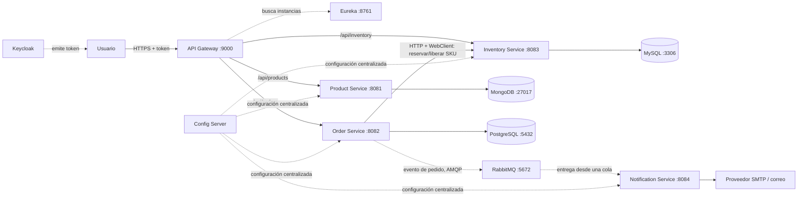

# Comunicación entre los microservicios

Este documento describe dos cosas por separado: **lo que plantea el esquema** y **lo que está conectado hoy en el código**. El diagrama es una arquitectura objetivo; no todos sus flujos están implementados todavía.

## Arquitectura prevista



Los servicios deberían ser propietarios de sus datos: Product trabaja con MongoDB, Order con PostgreSQL e Inventory con MySQL. Un servicio no debería leer directamente las tablas o colecciones de otro; para intercambiar información debe usar una API o publicar un evento.

## Flujo HTTP: usuario hacia una API

HTTP es apropiado cuando el usuario necesita una respuesta inmediata, por ejemplo, consultar o crear un producto:

1. El usuario se autentica con Keycloak y obtiene un token de acceso.
2. Envía una solicitud HTTPS al Gateway, por ejemplo `GET /api/products`.
3. El Gateway valida el token y dirige la petición al servicio correspondiente. En la arquitectura prevista, Eureka permite localizar las instancias disponibles.
4. Product Service procesa la petición y consulta o actualiza MongoDB.
5. La respuesta vuelve por el Gateway al usuario.

Las APIs directas `/api/products`, `/api/orders` y `/api/inventory` están implementadas. El Gateway, la autenticación y el acceso a estas rutas a través del Gateway siguen pendientes.

## Reserva de inventario entre Order e Inventory

Al crear un pedido, Order Service llama sincrónicamente a Inventory Service con `WebClient`:

```http
POST /api/inventory/{skuCode}/reservations
Content-Type: application/json

{"quantity": 2}
```

Inventory bloquea la fila del SKU durante la operación, comprueba el stock y lo descuenta de forma transaccional. Devuelve `204` si reserva, `404` si el SKU no existe y `409` si no hay suficiente stock. Order guarda el pedido después de reservar. Si falla el guardado, intenta liberar el stock; al actualizar ajusta la diferencia y al eliminar libera las cantidades del pedido.

La URL del servicio se configura con `INVENTORY_SERVICE_URL` (por defecto `http://localhost:8083`). Como se trata de dos aplicaciones MVC, Order usa `WebClient` de forma bloqueante en el flujo HTTP. La llamada remota y la escritura en PostgreSQL no forman una transacción distribuida; el mecanismo de compensación cubre fallos conocidos, pero para producción se necesitan operaciones idempotentes y reconciliación ante caídas durante la llamada.

## Flujo asíncrono: pedido y notificación con RabbitMQ

Una notificación por correo no necesita bloquear la respuesta de la API de pedidos. El servicio de pedidos puede publicar un **evento**, y Notification Service procesarlo cuando esté disponible:

1. El usuario envía la solicitud de pedido al Gateway.
2. Order Service solicita a Inventory Service reservar las cantidades de cada SKU mediante HTTP con `WebClient`.
3. Inventory Service descuenta el stock de forma transaccional y rechaza la reserva si no hay unidades suficientes.
4. Si las reservas terminan correctamente, Order Service guarda el pedido en PostgreSQL. Si falla el guardado, intenta liberar las reservas como compensación.
5. Después del commit de PostgreSQL, Order Service publica el evento `order.created` en el exchange `orders.events`.
6. Notification Service consume la cola `notification.order-created` y envía el correo. Si el envío falla, se reintenta y, tras agotar los intentos, el mensaje pasa a `notification.order-created.dlq`.

La respuesta HTTP del pedido y el envío del correo son trabajos distintos: la API puede responder una vez registrado el pedido, sin esperar al proveedor de correo. El código de respuesta concreto (por ejemplo, `201` o `202`) debe formar parte del contrato de la API.

### Conceptos de RabbitMQ

- **Productor:** aplicación que publica el mensaje; en este flujo sería Order Service.
- **Exchange:** recibe el mensaje y decide a qué colas enviarlo.
- **Routing key:** etiqueta que usa el exchange para enrutar; por ejemplo, `order.created`.
- **Cola:** almacena mensajes hasta que un consumidor pueda procesarlos; por ejemplo, `notification.order-created`.
- **Binding:** regla que relaciona un exchange con una cola.
- **Consumidor:** aplicación que lee y procesa los mensajes; en este flujo sería Notification Service.
- **ACK:** confirmación de que el consumidor procesó el mensaje. Sin ACK, el mensaje puede volver a entregarse.

El contrato usado incluye `eventId`, `eventType`, `occurredAt`, `orderId`, `customerEmail` y las líneas del pedido. Order y Notification declaran la misma topología AMQP para que el broker tenga exchange, cola, binding y dead-letter queue aunque los servicios arranquen en distinto orden.

La reserva HTTP y la escritura del pedido en PostgreSQL no forman una transacción distribuida. Order intenta compensar liberando stock si la escritura falla; si el servicio cae o la compensación no se puede completar, se requiere reconciliación. La publicación RabbitMQ ocurre después del commit: si el broker falla, el pedido queda guardado y la API informa el error. Para garantizar la publicación ante caídas conviene añadir Transactional Outbox; la entrega y el correo también pueden repetirse, por lo que un sistema productivo debe deduplicar `eventId`.

Un evento mínimo podría tener este formato:

```json
{
  "eventId": "identificador-unico",
  "eventType": "order.created",
  "occurredAt": "2026-11-25T17:00:00Z",
  "orderId": 123,
  "customerEmail": "cliente@example.com",
  "items": [
    { "skuCode": "ABC-123", "quantity": 2 }
  ]
}
```

El contrato real debe acordarse antes de conectar productor y consumidor. Conviene incluir un identificador de evento para poder detectar entregas duplicadas. En producción, también se deben definir reintentos, una cola de mensajes fallidos (DLQ), confirmaciones del productor y cómo mantener consistentes la escritura del pedido y la publicación del evento; el patrón **Outbox** puede evitar que se guarde el pedido sin que llegue a publicarse su evento.

RabbitMQ es un intermediario de mensajes, **no** una base de datos de pedidos. En el proyecto, AMQP utiliza el puerto `5672`; la interfaz de administración se publica en `15672`.

## Estado actual del repositorio

- **Product Service:** implementa endpoints CRUD bajo `/api/products` y usa MongoDB. Consulta [ProductController.java](./product-service/src/main/java/com/springboot_microservices/product_service/controller/ProductController.java) y [su configuración](./product-service/src/main/resources/application.yaml).
- **Inventory Service:** expone CRUD bajo `/api/inventory` y endpoints de reserva/liberación por SKU.
- **Order Service:** expone CRUD bajo `/api/orders`, persiste pedidos y líneas en PostgreSQL, reserva stock mediante `WebClient` y publica `order.created` tras guardar el pedido.
- **Notification Service:** consume `notification.order-created`. Con `NOTIFICATION_EMAIL_ENABLED=false` simula el envío y lo registra en el log; con `true` utiliza SMTP, que requiere configurar servidor y credenciales.
- **RabbitMQ:** [el script de infraestructura](./resources/start-dependencies.sh) crea el broker y las bases locales. Order y Notification declaran exchanges, colas, bindings y DLQ al iniciar.
- **Gateway, clientes Eureka, Config Server y Keycloak:** están representados en el esquema, pero todavía no están integrados en los servicios.

Product Service, Order Service e Inventory Service exponen APIs REST directas. Order → Inventory usa HTTP/WebClient; Order → RabbitMQ → Notification usa AMQP para la notificación de pedidos.

## Ejecución local y direcciones

Al ejecutar las aplicaciones directamente en el host, se conectan a las dependencias Docker por `localhost`:

| Componente | Dirección local | Estado |
|---|---|---|
| Gateway | HTTPS en el puerto `9000` (objetivo) | Puerto reservado; Gateway pendiente. |
| Eureka | `http://localhost:8761` | Aplicación presente; falta activar el servidor y registrar clientes. |
| Product Service | `http://localhost:8081/api/products` | CRUD disponible si MongoDB está iniciado. |
| Order Service | `http://localhost:8082/api/orders` | CRUD disponible; reserva stock en Inventory. |
| Inventory Service | `http://localhost:8083/api/inventory` | CRUD y endpoints de reserva si MySQL está iniciado. |
| Notification Service | `http://localhost:8084` | Consumidor AMQP; simula email por defecto y usa SMTP si `NOTIFICATION_EMAIL_ENABLED=true`. |
| RabbitMQ AMQP | `localhost:5672` | Broker iniciado por el script de infraestructura. |
| RabbitMQ Management | `http://localhost:15672` | Interfaz de administración local. |

Para iniciar las dependencias, ejecuta desde la raíz `./resources/start-dependencies.sh`. Sus credenciales son de desarrollo local. Si en el futuro los microservicios también se ejecutan dentro de Docker, `localhost` apuntará al propio contenedor de la aplicación; en ese caso deberán compartir una red Docker y usar los nombres DNS de los contenedores.
