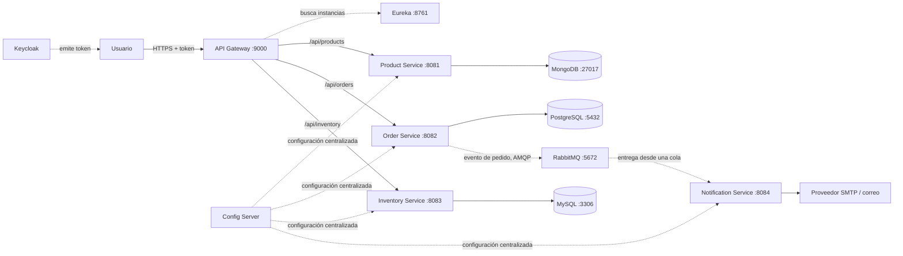

# Comunicación entre los microservicios

Este documento describe dos cosas por separado: **lo que plantea el esquema** y **lo que está conectado hoy en el código**. El diagrama es una arquitectura objetivo; no todos sus flujos están implementados todavía.

## Arquitectura prevista



Los servicios deberían ser propietarios de sus datos: Product trabaja con MongoDB, Order con PostgreSQL e Inventory con MySQL. Un servicio no debería leer directamente las tablas o colecciones de otro; para intercambiar información debe usar una API o publicar un evento.

## Flujo HTTP: usuario hacia una API

HTTP es apropiado cuando el usuario necesita una respuesta inmediata, por ejemplo, consultar o crear un producto:

1. El usuario se autentica con Keycloak y obtiene un token de acceso.
2. Envía una solicitud HTTPS al Gateway, por ejemplo `GET /api/products`.
3. El Gateway valida el token y dirige la petición al servicio correspondiente. En la arquitectura prevista, Eureka permite localizar las instancias disponibles.
4. Product Service procesa la petición y consulta o actualiza MongoDB.
5. La respuesta vuelve por el Gateway al usuario.

En el esquema, las rutas previstas son `/api/products`, `/api/orders` y `/api/inventory`. El comportamiento exacto de autenticación y las respuestas HTTP todavía deben definirse e implementarse.

## Flujo asíncrono: pedido y notificación con RabbitMQ

Una notificación por correo no necesita bloquear la respuesta de la API de pedidos. El servicio de pedidos puede publicar un **evento**, y Notification Service procesarlo cuando esté disponible:

1. El usuario envía la solicitud de pedido al Gateway.
2. Order Service valida y guarda el pedido en PostgreSQL.
3. Tras guardar el pedido, Order Service publica un evento en RabbitMQ, por ejemplo `order.created`.
4. RabbitMQ enruta el evento a una cola asociada a notificaciones.
5. Notification Service consume el mensaje y envía el correo.
6. Si el procesamiento termina correctamente, el consumidor confirma el mensaje (**ACK**). Si falla, RabbitMQ puede volver a entregarlo según la política de reintentos configurada.

La respuesta HTTP del pedido y el envío del correo son trabajos distintos: la API puede responder una vez registrado el pedido, sin esperar al proveedor de correo. El código de respuesta concreto (por ejemplo, `201` o `202`) debe formar parte del contrato de la API.

### Conceptos de RabbitMQ

- **Productor:** aplicación que publica el mensaje; en este flujo sería Order Service.
- **Exchange:** recibe el mensaje y decide a qué colas enviarlo.
- **Routing key:** etiqueta que usa el exchange para enrutar; por ejemplo, `order.created`.
- **Cola:** almacena mensajes hasta que un consumidor pueda procesarlos; por ejemplo, `notification.order-created`.
- **Binding:** regla que relaciona un exchange con una cola.
- **Consumidor:** aplicación que lee y procesa los mensajes; en este flujo sería Notification Service.
- **ACK:** confirmación de que el consumidor procesó el mensaje. Sin ACK, el mensaje puede volver a entregarse.

Como propuesta inicial, se podría usar un exchange `orders.events`, una routing key `order.created` y una cola `notification.order-created`. Son nombres ilustrativos: el repositorio todavía no define exchanges, colas, bindings ni un contrato de evento.

Un evento mínimo podría tener este formato:

```json
{
  "eventId": "identificador-unico",
  "eventType": "order.created",
  "occurredAt": "2026-11-18T12:00:00Z",
  "orderId": "identificador-del-pedido",
  "customerEmail": "cliente@example.com"
}
```

El contrato real debe acordarse antes de conectar productor y consumidor. Conviene incluir un identificador de evento para poder detectar entregas duplicadas. En producción, también se deben definir reintentos, una cola de mensajes fallidos (DLQ), confirmaciones del productor y cómo mantener consistentes la escritura del pedido y la publicación del evento; el patrón **Outbox** puede evitar que se guarde el pedido sin que llegue a publicarse su evento.

RabbitMQ es un intermediario de mensajes, **no** una base de datos de pedidos. En el proyecto, AMQP utiliza el puerto `5672`; la interfaz de administración se publica en `15672`.

## Estado actual del repositorio

- **Product Service:** implementa endpoints CRUD bajo `/api/products` y usa MongoDB. Consulta [ProductController.java](./product-service/src/main/java/com/springboot_microservices/product_service/controller/ProductController.java) y [su configuración](./product-service/src/main/resources/application.yaml).
- **Inventory Service:** tiene configuración MySQL y una entidad/repositorio, pero todavía no expone endpoints ni completa la lógica del servicio.
- **Order Service:** tiene configurada la conexión a PostgreSQL, pero aún no tiene entidades, endpoints ni productor de eventos.
- **Notification Service:** tiene dependencias de RabbitMQ y correo, y la conexión local al broker configurada; todavía no tiene consumidor ni envío de emails.
- **RabbitMQ:** [el script de infraestructura](./resources/start-dependencies.sh) crea el broker y las bases locales. No crea exchanges, colas ni bindings.
- **Gateway, clientes Eureka, Config Server y Keycloak:** están representados en el esquema, pero todavía no están integrados en los servicios.

Por tanto, el único flujo de API visible actualmente es el acceso directo a Product Service. El flujo Order → RabbitMQ → Notification descrito arriba explica cómo debería funcionar al implementar esos componentes, no un flujo que ya se pueda ejecutar.

## Ejecución local y direcciones

Al ejecutar las aplicaciones directamente en el host, se conectan a las dependencias Docker por `localhost`:

| Componente | Dirección local | Estado |
|---|---|---|
| Gateway | HTTPS en el puerto `9000` (objetivo) | Puerto reservado; Gateway pendiente. |
| Eureka | `http://localhost:8761` | Aplicación presente; falta activar el servidor y registrar clientes. |
| Product Service | `http://localhost:8081/api/products` | CRUD disponible si MongoDB está iniciado. |
| Order Service | `http://localhost:8082` | Puerto configurado; API pendiente. |
| Inventory Service | `http://localhost:8083` | Puerto configurado; API pendiente. |
| Notification Service | `http://localhost:8084` | Puerto configurado; consumidor pendiente. |
| RabbitMQ AMQP | `localhost:5672` | Broker iniciado por el script de infraestructura. |
| RabbitMQ Management | `http://localhost:15672` | Interfaz de administración local. |

Para iniciar las dependencias, ejecuta desde la raíz `./resources/start-dependencies.sh`. Sus credenciales son de desarrollo local. Si en el futuro los microservicios también se ejecutan dentro de Docker, `localhost` apuntará al propio contenedor de la aplicación; en ese caso deberán compartir una red Docker y usar los nombres DNS de los contenedores.
